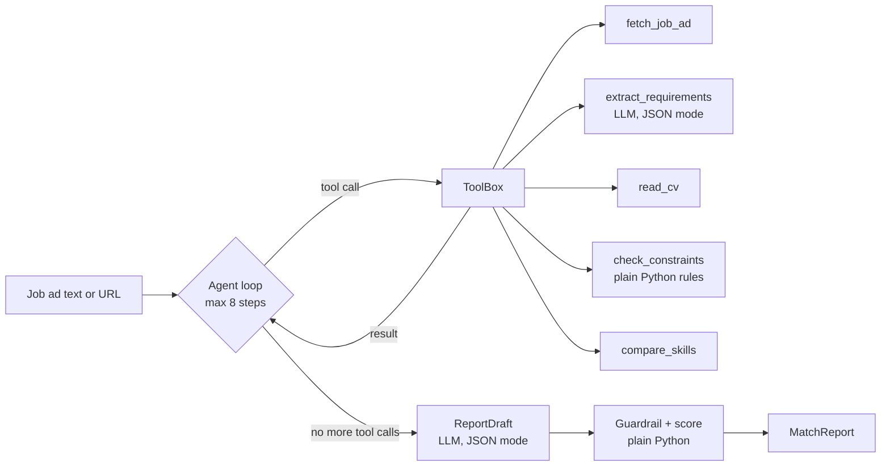

# Job Match Agent – an LLM agent with tool calling

Paste a job ad (text or link). The agent reads it, compares it with a CV, checks it against
my job-search rules and returns a **validated match report**: score, verdict, matching and
missing skills, which CV version to send, red flags and honest tips.

I built it for my own working-student job search: many ads are in German, need full-time hours
or are far away, and checking each one by hand takes time.

## What makes it more than a "ChatGPT wrapper"
- **Real tool calling** – the LLM (Google Gemini) decides which of 5 tools to call, in a loop,
  instead of answering one big prompt.
- **Structured output** – requirements and the final report are JSON validated with Pydantic.
- **Guardrail in code** – the report may only list skills that are really in the CV. If the
  model "invents" a matching skill, code removes it, counts it as missing and shows that it did.
- **Rules in code, not in the prompt** – location, hours and language checks are plain Python,
  so they are predictable and unit-tested. The score is computed by code too.
- **Evaluation** – 12 labelled job ads and `eval/eval.py`, which measures how often the agent
  gets the labels right.
- **Engineering** – 33 pytest tests with a fake LLM (no API key needed), GitHub Actions CI, Dockerfile.

## How it works



1. The job ad and the list of tools (name, description, JSON schema of the arguments) go to Gemini.
2. Gemini answers with **tool calls**. `ToolBox` runs them and the results go back to the model.
3. This repeats until the model has everything (or the step limit is reached).
4. A last call in **JSON mode** returns a `ReportDraft` (summary, skills, CV version, tips).
5. Code checks the draft: invented skills are removed, red flags come from the rule check,
   and the score is `skills covered % − 30 per red flag`.

| Tool | What it does |
|---|---|
| `fetch_job_ad(url)` | Downloads a page and extracts the readable text (stdlib HTML parser) |
| `extract_requirements()` | LLM turns the ad into a `Requirements` object: title, location, work mode, min hours, German level, skills |
| `read_cv()` | Loads the CV markdown and its skill list |
| `check_constraints(...)` | Location (Deggendorf–Munich–Regensburg area or remote), max 20 h/week, no fluent German required |
| `compare_skills(required_skills)` | Matching and missing skills, with spelling normalisation (`sklearn` = `scikit-learn`) |

The ad text is stored in the `ToolBox`, so the model never has to copy thousands of characters
into a tool argument.

### Project layout
```
app.py               Streamlit UI
agent/llm.py         Gemini client – the only file that talks to the API
agent/agent.py       agent loop, guardrail, score
agent/tools.py       the 5 tools + JSON schemas for the model
agent/models.py      Pydantic models (Requirements, ReportDraft, MatchReport …)
agent/config.py      my rules: allowed towns, max hours, CV versions
data/sample_cv.md    fictional sample CV (use data/my_cv.md for your own – it is gitignored)
eval/                12 job ads, expected.csv, eval.py
tests/               pytest with a fake LLM
```

## Evaluation
`eval/job_ads/` holds 12 **fictional** job ads written in the style of real working-student
postings (two are in German). `eval/expected.csv` holds my labels for each:
fit, location OK, hours OK, language OK.

```bash
python eval/eval.py              # runs every ad that has no saved result yet
python eval/eval.py --only 02 03 # re-run single ads
```

One ad needs about 5 API requests, and the Gemini free tier allows only about 20 requests per
model per day. So the eval is **resumable**: every finished ad is saved to `eval/results.csv`
right away, a quota error stops the run, and the next run continues with the missing ads.
API failures (quota, overload, network) are skipped, not counted as wrong answers.
The per-minute rate limit is handled in `agent/llm.py`: if Google says "retry in 20 s", the
client waits and retries; only a wait of hours (the daily limit) stops the run.

Result: *in progress – the number will be added here once all 12 ads have run
(full table in `eval/results.md`).*

## Run it
```bash
python -m venv .venv
.venv\Scripts\activate          # Windows  (macOS/Linux: source .venv/bin/activate)
pip install -r requirements.txt
copy .env.example .env          # then put your Gemini API key into .env
streamlit run app.py
```
A free API key is available at [Google AI Studio](https://aistudio.google.com/apikey).
The default model is set in `.env` (`GEMINI_MODEL`).

**Docker**
```bash
docker build -t job-match-agent .
docker run -p 8501:8501 --env-file .env job-match-agent
```

## Tests
```bash
python -m pytest
```
The LLM is replaced by a scripted fake (`tests/fake_llm.py`), so the tests run offline and
in CI without a key. They cover the rule checks, skill matching, HTML parsing, the agent loop
(tool order, results sent back, step limit, URL input) and the guardrail.

## Limitations
- The eval set is small (12 ads) and labelled by me, so accuracy is only a rough signal.
- Requirement extraction depends on the LLM; a wrong German level or hours value changes the result.
- Skill matching is by name. "Machine learning" in an ad does not automatically match
  "scikit-learn" in the CV – the model can map it, but only to skills that are in the CV.
- `fetch_job_ad` cannot read pages that need JavaScript; paste the text instead.
- The rules in `agent/config.py` are mine (Bavaria, non-EU student hours); change them for your own search.

## Tech
Python · Google Gemini API (function calling, JSON mode) · Pydantic · Streamlit · pytest ·
GitHub Actions · Docker
